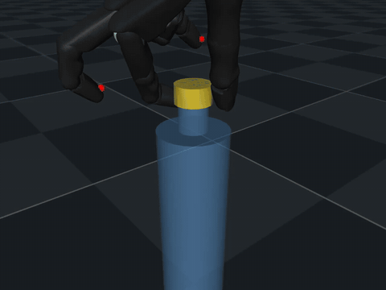

# hand-sim

Shadow Hand unscrewing a bottle cap by finger gaiting. Built from [`PRD.md`](PRD.md), one
milestone at a time; deviations, measured numbers and open questions live in
[`NOTES.md`](NOTES.md).



The M8 policy at **5x slow**, `cap` camera, fingertip sites and contact forces drawn -- one
stroke-and-regrip cycle out of the ~93 it does per episode. Re-simulated on CPU at substep
resolution rather than stretching the 20 Hz saves, and it tracks the recorded GPU trajectory to
0.14%. Full 60 s episode across all three cameras:

```bash
python3 scripts/eval.py logs/capturn-nominal-s1/checkpoints/.../000150732800 --save 4
python3 scripts/render.py artifacts/m8_s1_ep00.npz --camera all --sites --contacts
```

**M5 (nominal training): criterion 1 passes, criterion 2 does not.** The scene and reward
changes did most of what they were meant to -- parity improves 2.2% -> **0.2%**, warp reports
**no overflow at all**, the pregrasp parking reward drops +0.978 -> **+0.038**, rotation falls
~370 -> **155 deg/s** and penetration is clean at -0.309 mm. But measured with the reward's own
`grasp_state` (which `eval.py` did not report until now), the policy is **not** doing a lateral
pinch: thumb and index sit on the **same side** of the cap (opposition -0.627 median, opposed
on 1.6% of steps), so the grasp term pays **0.000** and the policy is optimising rotation
alone, hovering at 9.8/12.2 mm to stay inside the 20 mm grasp-loss bound on 100% of steps.
The cause was structural -- `clip(opposition, 0, 1)` has no gradient below zero, so the term
could not teach the grip it asks for. **Reshaping that one factor to `0.5 * (1 + opposition)`
fixes it**: opposition goes -0.627 -> **+0.794** (opposed on 75% of steps), the grasp term
0.000 -> **0.550**, and the gaps collapse 9.8/12.2 mm -> **2.9/0.3 mm**, so the hover is gone
too. Penetration rises to -0.781 mm and `EPA_HORIZON` returns, both from making real contact.
Across seeds it is **not yet reliable**: seed 1 reaches +0.600 opposition with all three
fingertips regripping and contact lost on only 9% of steps, while seed 2 falls back to -0.463
and a 9.6 mm index gap. Both score 100% on criterion 1. Two seeds; the third was lost to a
preemption.

**The two-finger pinch (thumb and index only) is implemented and is currently a regression**:
of two seeds, one fails the task outright (0% success) and the other succeeds with a worse
grasp than the three-finger config. The cause is measured -- the `idle_contact` cost penalises
how *close* the unused fingers are rather than whether they are helping, and its tail is wide
enough (0.368 at 10 mm) that the only way to satisfy it is to lift the whole hand off the cap.
It would also penalise the M1 reference gait by -5.3 of return.

Sharpening that cost (`idle_sharpness = 500`, validated first against the M1 gait, whose
penalty falls to -0.37) **undoes the regression**: opposition back to +0.602, thumb/index gaps
2.18/0.21 mm, penetration -0.198 mm and no warp overflow -- the best grasp numbers in the
project. It does **not** achieve what the change was for: the middle finger backs off by 3.4 mm
and stays the closest tip. Separating "resting on the cap" from "8 mm away" needs contact force,
not a fingertip-site distance. Details in [`NOTES.md`](NOTES.md), M5.

**M6 (reward design): the M5 reward ranked the reference gait last of five.** Scoring every
trajectory in `artifacts/` with the live reward -- the hand-authored scripted gait and the four
policies M5 produced -- the M5 reward puts the **flick exploit first** and the **scripted gait
last**, by 2.3x; a policy that failed the task outright still outranks the gait by 2.1x. Two
compounding causes: the terms were *added*, so turning the cap badly and holding it well were
alternatives rather than one behaviour, and `rotate`'s per-step rate clip paid a bursty gait
only **50.1%** of its own rotation while paying a continuous grinder all of it. Tightening that
clip -- the obvious first move -- pays the gait 17%.

So rotation is now paid *by* the grasp and budgeted per grip:
`twist = pinch * clip(d_theta, 0, stroke_budget_remaining) / dt`, with the 60 deg budget
refilling only when a new grip begins. Two full turns then need at least twelve strokes, which
makes "twist it several times" a consequence of the budget rather than a term asking for cycles.
With `slip`, `backdrive` and a bottle-contact cost added, and opposition saturating at 150 deg
(where the re-fitted pose puts the pinch) instead of 180 (where the bottle neck is), **the
ranking inverts completely**: the scripted gait is the only trajectory with a positive return
and the flick is last. `paid_rotation / cap_rotation_abs` is 100% for the gait and 7-11% for
every policy. Nothing has trained yet. Details in [`NOTES.md`](NOTES.md), M6.

One thing M6 explicitly does not fix: a person unscrews a cap with **forearm pronation**, and
this hand has none -- the forearm is fixed and the wrist only flexes and deviates. The task as
specified is finger-gaited in-hand rotation, and M6 shapes the grasp, the stroke and the cadence
of the human motion but not its actuation.

**M7 adds the pronation joint** (`rh_WRJ0`, -90 to +10 deg) and paid cap rotation only to the
extent the forearm accounted for it. **M8 corrects that overcorrection**: measured at the
contact points, the index MCP sweeps the index pad 106.7 deg around the cap axis per radian
against the forearm roll's 38.5, so the finger is 2.8x the lever -- and M7 was charging all of it
at -0.5. The reward now pays rotation the **two pads carried** without slipping, `min` over the
pair, which admits fingers, forearm or both and still refuses slip and shear. The pure-finger
gait goes from -0.256/s under M7 to **+0.165/s**.

**M8 also re-fits the pregrasp**, which was gripping the cap's bottom lip -- the index pad at
cap-frame z = **-5.5 mm** on a cap spanning ±8 mm, and 0.63 mm off the surface, so already
loaded with nothing left to squeeze. The fitter was constraining fingertip *sites* while the
reward measures the nearest point of the collision *geoms*, and its settled stage froze the
hand's mount, the one variable that decides how far it sags (settled cost 470 -> **5.69** once
freed). Both pads now sit near the cap's mid-band with ~3 mm of clearance, pad separation 148.9
deg against a 149 target, and the reference gait touches the bottle on **0** of 264 steps where
it used to on 91 of 220.

**And `rh_WRJ0`'s range narrows 90 deg -> 45.** The reward is deliberately indifferent to which
joints turn the cap, so the fingers' share has to come from the morphology. At 90 deg one stroke
turns the cap 92 deg and the scripted gait carries 9% of its rotation on the fingers; at 45 deg
it carries **26%**. 45 is the smallest range that keeps the trajectory clean -- below it the
finger share is bought with slip rather than finger work. This did what an explicitly
finger-sweeping gait could not: that gait buys 4 points of finger share for 11 points of slip,
because gripping and sweeping draw on the same actuators. Parity is **0.0%** on both criteria.
Details in [`NOTES.md`](NOTES.md), M8.

**M8 trained, and the PRD's M5 is met.** One seed to 150M steps on an H200, 2.2 h at 18,771
steps/s all-in. Over 1024 deterministic episodes the policy succeeds **100.00% +- 0.00** against
the PRD's 80% bar, turning the cap **+13,222 deg** (36.7 turns) at net/gross **+0.991**, with
opposition +0.919 and *opposed on 100% of steps*, both gaps under 0.3 mm, no drops, and the
cleanest contact the project has trained: **-0.170 mm** of penetration against M1's -0.566. The
policy's own trajectory replays CPU-vs-warp at **0.0%** and is timestep-converged at 0.0%, so
none of it is solver error -- but it wants `njmax` 110 per world where the scripted gaits wanted
84, which is the standing lesson in the other direction: *a trained policy loads the scene harder
than any script used to size the buffers.*

**The route is the forearm, and that is a judgement call rather than a measurement.** The policy
clamps a lateral pinch, pronates to the stop, walks the index pad around the cap and repeats --
~93 strokes an episode at ~1.5 Hz. 74.7% of joint travel is fingers and the index regrips
**89.9 times per episode**, but the thumb regrips **0.00** times and `finger_carried_rotation`,
the metric M8 added for exactly this question, reads **0.0%**: no rotation at all is carried
while the forearm is still. Reviewed on video and called a pass -- the index regripping ~90 times
an episode is the gait, and pronation is the hand using a joint M7 deliberately gave it. The
reward pays fingers and forearm alike by design, so this is the route it permits, not the route
it asks for. One seed, where the convention here is three.

## Setup (Mac, CPU)

```bash
pip install mujoco playground mediapy scipy pytest
```

## Watching it

```bash
# the open-loop gait, re-simulated live in the viewer, looping
python3 scripts/squeeze_twist.py          # generate the trajectory first (~2 s)
python3 scripts/view_scene.py --play
python3 scripts/view_scene.py --play --speed 0.25     # slow motion

# the static pregrasp pose -- ctrl+drag the cap to feel the hinge friction
python3 scripts/view_scene.py

# an mp4 you can scrub or share
python3 scripts/render.py --camera all --sites
open artifacts/squeeze_twist.mp4
```

In the viewer: turn on **site** under the Rendering panel to see the fingertip and cap markers,
and **contact force** to see where the grip is acting. `[` and `]` cycle the cameras
(`front`, `cap`, `back`).

## Checking it

```bash
python3 -m pytest tests/ -q               # 81 checks, ~25 s -- the M0-M6 done-criteria
HAND_SIM_SLOW=1 python3 -m pytest tests/ -q   # adds the MJX-Warp rollouts (minutes on CPU)
python3 scripts/view_scene.py --report    # scene summary, actuator limits, pregrasp geometry

# what the reward would pay for every trajectory in artifacts/, before spending a GPU hour
python3 scripts/score_reward.py
python3 scripts/score_reward.py artifacts/squeeze_twist.npz --per-step

# CPU MuJoCo vs MJX-Warp, plus buffer sizing for training
python3 scripts/check_parity.py
python3 scripts/check_parity.py --probe   # just naconmax / njmax
```

`warp-lang` ships a CPU build, so MJX-Warp runs on the Mac -- slowly, but it is the real
backend. `impl='jax'` cannot run this scene (no cylinder/mesh collisions).

## On the GPU box

```bash
export XLA_PYTHON_CLIENT_PREALLOCATE=false
unset MUJOCO_GL          # EGL broke `import mujoco` on the M3 image; re-check on a new box
python3 -c "import jax; print(jax.default_backend())"   # must print: gpu

python3 scripts/squeeze_twist.py     # regenerate the trajectory at the current timestep
python3 scripts/check_parity.py      # M2 on CUDA
python3 scripts/benchmark.py --num-envs 8192 --out artifacts/bench_h200.json
```

**Run one `num_envs` per process.** With `XLA_PYTHON_CLIENT_PREALLOCATE=false` JAX grows its
pool and never releases it, so sweeping several env counts in one process starves Warp and the
largest one fails to allocate. This is why the H100's `num_envs = 16384` failure is not a real
ceiling, and is worth one fresh-process retry on the H200's 141 GiB (NOTES.md, M3).

There is no `git` on the box -- sync with `tar czf - . | ssh HOST 'tar xzf - -C ~/hand-sim'`.

## The training env

```bash
python3 -m pytest tests/test_env.py -q                    # layout, config, geometry
HAND_SIM_SLOW=1 python3 -m pytest tests/test_env.py -q    # + physics, ~7 min on the Mac
```

```python
from capturn import CapTurn, default_config, ppo_config

env = CapTurn()                       # nominal phase: no observation noise, no action delay
env.observation_size                  # {'state': (210,), 'privileged_state': (283,)}
```

Asymmetric actor-critic: `state` is 3 stacked frames of what a real hand could measure,
`privileged_state` adds velocities, cap rotation, fingertip geometry, actuator forces and a
zeroed slot for the DR parameters. The actor never sees the cap angle -- the cap is
rotationally symmetric, so it does not need it and could not measure it on hardware.

The action is a delta on the position targets, integrated out of `data.ctrl` rather than out of
a copy in `state.info`. That is deliberate: Playground's auto-reset wrapper restores `data` at
an episode boundary but leaves `info` alone, so anything cached there leaks into the next
episode. `ppo_config()` asks for `full_reset=True` as well, because otherwise every env restarts
from the one state cached at the first reset. Both are covered by tests and written up in
`NOTES.md`, M4.

`reach` was replaced by `grasp` at M5, after the first trained policy turned the cap with the
*side* of its index finger and no thumb at all -- the right contact surface, but a one-sided
push rather than a grasp. `reach` watched three fingertip sites and could not see it. `grasp`
asks for what a bottle-cap grasp actually is: the thumb and the index finger both on the cap,
anywhere along their length, and on opposite sides. See `NOTES.md`, "What the flick policy was
actually doing". `action_rate` at 0.01 is still a third of the reward signal for an untrained
policy. Measured numbers in `NOTES.md`.

At M6 `rotate` became `twist`, which is `grasp` times the rotation the current grip's 60 deg
budget still allows -- so rotation produced without a pinch pays nothing (and `slip` charges for
it), and a grip that never releases is paid for one stroke however far it turns the cap. The
reason it is a product rather than a second term is measured rather than argued:
`scripts/score_reward.py` scores a saved trajectory with the live reward, and under the M5
weights the scripted reference gait came last of five. `tests/test_reward_ranking.py` pins the
ordering so that cannot happen quietly again.

## Training

```bash
# on the H200
export XLA_PYTHON_CLIENT_PREALLOCATE=false
unset MUJOCO_GL
tmux new -s train
python3 scripts/train.py --wandb                      # nominal, 150M steps, ~2 h
python3 scripts/train.py --num-timesteps 20_000_000   # a shorter shakeout first
python3 scripts/train.py --resume                     # after a preemption
```

The box is spot and its disk does not survive a stop, so `--resume` is the only thing standing
between a preemption and starting over. It needs no arguments: the run name is derived from the
phase and seed rather than a timestamp, so it finds the W&B run and its newest checkpoint
artifact on its own, and spends only the step budget that is left. A checkpoint is written and
uploaded roughly every 3.5 minutes (`--checkpoint-every MIN` to change that).

Nothing in `train.py` renders -- `MUJOCO_GL=egl` breaks `import mujoco` on the Daytona image.

```bash
# success rate and the exploit checks, on the box
python3 scripts/eval.py logs/capturn-nominal-s1/checkpoints --save 4 \
    --out artifacts/eval_nominal.json

# then, on the Mac
python3 scripts/eval.py --wandb-artifact ckpt-capturn-nominal-s1:latest --save 4
python3 scripts/render.py artifacts/eval_000150000000_ep00.npz --camera all --sites
```

`eval.py` answers both halves of the M5 criterion. The success rate is over 1024 episodes with
the deterministic policy. The second half -- "real finger gaiting with no exploit" -- is four
measurements instead of four videos: net/gross rotation (1 is one direction, 0 is shaking the
cap), regrips per gaiting fingertip (a gait has to let go), the wrist's share of the joint
travel (2 of 24 joints; more than that and the fingers are passengers), and the deepest contact
penetration, replayed through CPU MuJoCo so it is comparable to M1's -0.566 mm.

```bash
python3 -m pytest tests/test_train.py -q                  # 32 checks, ~5 s
HAND_SIM_SLOW=1 python3 -m pytest tests/test_train.py -q  # + train -> resume -> eval, ~5 min
python3 scripts/train.py --smoke                          # just the training half, ~1 min
```

`capturn/compat.py` carries two shims, because Brax 0.14.2 and JAX 0.11.2 cannot train and then
load what they trained: JAX removed `jax.device_put_replicated`, which `ppo.train` still calls,
and Brax's checkpoint `save` writes a `None` kernel initialiser that its own `load_config`
cannot read back. Both shims have tests that fail when the upstream bug is fixed, so they get
deleted rather than inherited. Details in `NOTES.md`, M5.

## Changing the scene

The hand placement and the `pregrasp` keyframe are solved numerically, not hand-tuned. After any
change to the bottle or cap geometry, re-fit them:

```bash
python3 scripts/fit_pregrasp.py           # report only
python3 scripts/fit_pregrasp.py --write   # patch assets/right_hand_mjx.xml and assets/scene.xml
```

**After any `--write`, re-run the gait before trusting the new pose.** The fitter's objective is
a proxy for gaiting quality, not a measure of it: one re-fit scored better on every term and
gaited at 5 degrees instead of 88, because it left the thumb 0.7 mm off the cap wall.

```bash
python3 scripts/squeeze_twist.py --sweep
python3 scripts/squeeze_twist.py --fingers th,ff     # the PRD's two-finger version
```

## Layout

```
assets/shadow_hand/        pristine mujoco_menagerie right hand (commit feadf76), LICENSE kept
assets/right_hand_mjx.xml  derived copy: fingertip sites, fitted mount, scene owns <option>
assets/scene.xml           hand + fixed bottle + hinged cap, sensors, pregrasp keyframe
capturn/scene.py           scene path and cap geometry, shared with the scripts
capturn/env.py             the MjxEnv subclass -- obs, reward, termination
capturn/config.py          env config and the Brax PPO config
capturn/compat.py          two shims for the installed Brax/JAX pair
scripts/                   fit_pregrasp, view_scene, squeeze_twist, check_parity,
                           benchmark, train, eval, render, score_reward
tests/                     M0 scene checks, M1 gait, M2 parity, M3 benchmark harness,
                           M4 env, M5 training and eval, M6 reward ranking
artifacts/                 generated trajectories and video (gitignored)
logs/                      training runs: checkpoints and configs (gitignored)
```
